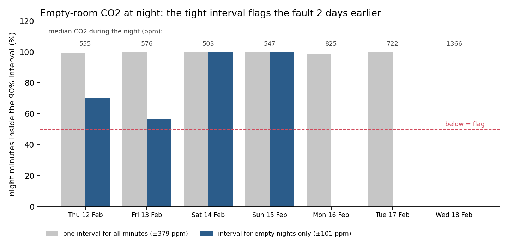

# Virtual CO₂ Sensor

[](https://github.com/Zolnarb1/virtual-co2-sensor/actions/workflows/ci.yml)  [](LICENSE)

**Can cheap sensors (temperature, humidity, light) replace a CO₂ sensor, for estimating air quality or for detecting whether a room is occupied? And can the model tell when the real sensor is wrong?**

Uses the [UCI Occupancy Detection dataset](https://archive.ics.uci.edu/dataset/357/occupancy+detection) (Candanedo & Feldheim, 2016): one office, one reading per minute, February 2015, with ground-truth occupancy. Training uses 2–10 Feb; **all results are on 11–18 Feb, days the models never saw.**

## Results

### 1. Occupancy: you don't need the CO₂ sensor


| Sensors used | Accuracy | F1 |
|---|---|---|
| **Light only** | **99.3%** | **0.983** |
| Cheap sensors + time features | 99.3% | 0.984 |
| Everything incl. CO₂ | 99.3% | 0.983 |
| Temperature + humidity | 84.4% | 0.664 |
| **CO₂ only** | 78.3% | 0.540 |
| *Always "empty" (no model)* | 79.0% | 0 |

A light sensor alone gives the same accuracy as all sensors combined. CO₂ on its own is barely better than always guessing "empty": it reacts slowly (it builds up over minutes) and stays high after people leave.

### 2. Virtual CO₂ sensor: honest uncertainty, and a fault detector


The model (linear regression on cheap sensors, time of day, and physics-inspired "accumulation" features: minutes of lights-on over the past 30–240 min) is wrapped in **split conformal prediction**, which turns any regressor into one with a 90% prediction interval calibrated on held-out data.

| Day | Empty-room CO₂ (ppm) | Readings inside the 90% interval | |
|---|---|---|---|
| 11–16 Feb | 485–697 | 71%–100% | ok |
| 17 Feb | 706 | 76% | ok |
| **18 Feb** | **1,031** | **0%** | **fault flagged** |

On 18 Feb the room is empty almost all day (1.6% occupied), yet the physical sensor reads 1,030–2,076 ppm. Outdoor air is ~400 ppm, so either **the CO₂ sensor drifted or the ventilation failed.** The virtual sensor, which only sees light, temperature and humidity, says the room should be near its normal level, and none of the readings fall inside its interval. Its disagreement is the alarm.

### 3. What doesn't work: exact ppm values (negative result)
| Model | MAE before the fault (ppm) | 90% interval half-width | Coverage on test days |
|---|---|---|---|
| Mean (no model) | 172 | ±944 | 98% |
| Linear regression | 175 | **±379** | 85% |
| Gradient boosting | 184 | ±405 | 85% |

Cheap sensors **cannot reconstruct the exact CO₂ value**: the point error is no better than always predicting the average. The model's value is a much tighter interval (±379 vs ±944 ppm), tight enough to catch the fault, which the "average" model's interval would miss. Coverage is 85% instead of the target 90% because the test week drifts away from the training weeks. Conformal guarantees assume the future looks like the calibration data, and here it doesn't quite.

### 4. Catching the fault 2 days earlier: one interval per regime (v0.2)
One interval width for every minute is wasteful. The model is unreliable when people are in the room (headcount is invisible to cheap sensors) but very reliable at night in an empty, dark room, where CO₂ should sit near outdoor air. **Mondrian (group-conditional) conformal prediction** calibrates a separate width per regime, using only the light sensor and the clock:

| Regime | 90% interval half-width |
|---|---|
| one interval for everything (v0.1) | ±379 ppm |
| lights on | ±506 ppm |
| lights off (evenings, weekends) | ±354 ppm |
| **night (00:00–06:00), lights off** | **±101 ppm** |



Watching only the empty nights with the tight interval:
- **The fault shows up on Monday 16 Feb, two days before the v0.1 alarm.** The room had been empty all Sunday, yet night-time CO₂ sat at 825 ppm, which working ventilation can't produce. The global ±379 ppm interval still counted 99% of those minutes as normal.
- 12–13 Feb are borderline (56–71% inside, night CO₂ 555–577 ppm): a slight drift, not flagged by the 50% rule. A stricter rule would flag them but would also raise more false alarms; one test week can't settle that threshold.
- Same linear model, same calibration data: the only change is how the uncertainty is calibrated. Unit-tested on synthetic data, where each group gets ~90% coverage at its own width.

### 5. Physics instead of ML? Also no (negative result, v0.2)
I also tried the textbook model: CO₂ rises by a constant amount per minute while the lights are on and decays towards a base level through ventilation. It has 3 parameters, fitted on the training days.
- The fit is physically plausible: a ventilation time constant of **68 min**, a base level of 443 ppm and +8.9 ppm per occupied minute. On the training days its error is 98 ppm.
- **On unseen days it is worse than the average** (MAE 146 vs 91 ppm, test days before the drift).
- The data shows why. With the same ~500 occupied minutes, peak CO₂ was 720 ppm on one day and 2,028 on another. The number of people (and whether a window was open) changes everything, and no cheap sensor sees it.

So the honest conclusion holds: cheap sensors can tell *whether* the room is occupied and *whether the CO₂ reading is plausible*, but not *how many ppm*.

## Reproduce
```bash
python -m venv .venv && .venv\Scripts\activate
pip install -r requirements.txt && pip install -e .
python -m vsensor.experiments     # downloads the data (~0.3 MB), prints all tables
python -m vsensor.plots
pytest
```

## Layout
```
src/vsensor/data.py         download, train/test split by date, time + accumulation features (past-only)
src/vsensor/conformal.py    split + Mondrian (group-conditional) conformal prediction, from scratch
src/vsensor/experiments.py  occupancy ablation, virtual CO2 sensor, fault checks, mass-balance model
src/vsensor/plots.py        charts
tests/                      conformal coverage (global and per group), no look-ahead, mass balance
```

## Author
Hamza Fakhri, Computer Science engineering student, Polytech Nantes. Built on an idea from my 2024 internship on environmental sensor data: how many sensors do you really need?

## License
MIT, see [LICENSE](LICENSE). The public datasets used here keep their own licenses (sources linked above).
